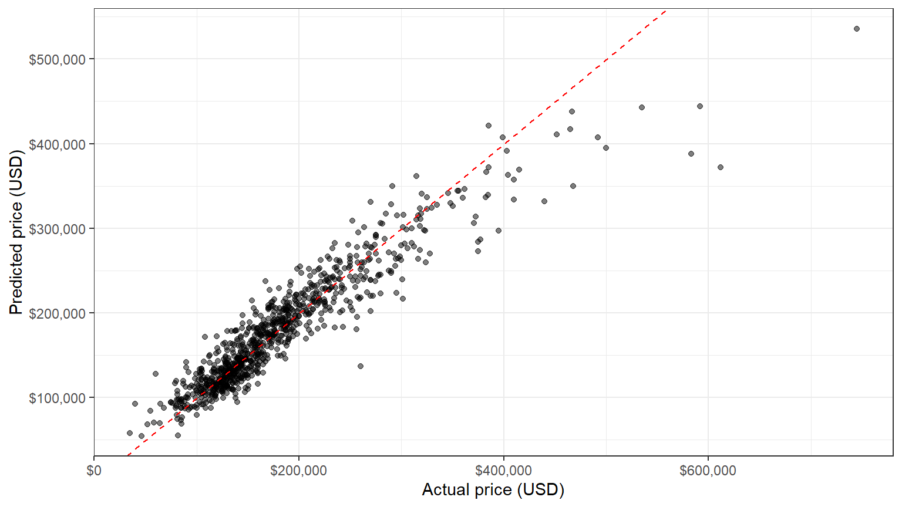

# What Drives House Prices in Ames, Iowa?

Explains and predicts the sale prices of 2,930 houses sold in Ames, Iowa
(2006–2010) with a log-linear regression, full OLS diagnostics, and a
comparison with Ridge and Lasso. Models are evaluated on a held-out test set
in dollars. Written in R and published as a Quarto website.

**Live report:** https://xwmara.github.io/house-price-regression/



## Key findings

- **The model prices unseen houses within about 11% on average.** On a test
  set of 881 houses, the multiple log regression has a mean absolute error of
  $18,700 (MAPE 10.8%) and explains 87% of the price variation, against
  $37,722 and 50% for living area alone.
- **Quality, size and location drive prices.** Each step on the 10-level
  quality scale adds about 11% to the price, a 10% larger house costs about
  4.4% more, and the same house costs about 37% more in the most expensive
  neighborhood than in the cheapest. Room counts add little once living area
  is known.
- **Ridge and Lasso do not beat OLS.** With 2,049 training houses for 32
  predictors and moderate multicollinearity (largest VIF 5.3), the best
  regularized model has a test RMSE of $28,221 against $28,079 for OLS.
- **The largest errors come from unusual sales.** Only 24% of the houses with
  extreme residuals were normal sales, against 82% overall. Foreclosures,
  family sales and unfinished houses sell far from their modeled value, which
  matters for collateral valuation.
- **Prediction intervals need care.** The residuals have heavy tails, so
  normal 95% intervals cover 96.9% of test prices; intervals built from the
  empirical residuals cover 95.5% and are narrower.

## What the analysis covers

| Area | Methods |
|---|---|
| Data preparation | variable selection, log transforms, stratified 70/30 train/test split, grouping of rare neighborhoods on the training set only |
| Exploratory analysis | descriptive statistics, distributions, correlation matrix, K-Means segmentation (elbow plot), PCA |
| Regression | simple OLS, multiple log-log OLS with neighborhood dummies, percentage interpretation of log coefficients |
| Diagnostics | Ramsey RESET, Breusch-Pagan, Durbin-Watson, Jarque-Bera, VIF, Cook's distance, HC3 robust and neighborhood-clustered standard errors, outlier robustness check |
| Prediction | test-set RMSE / MAE / MAPE / R² in dollars, Duan's smearing correction, errors by price segment, scenario forecasts with normal and empirical prediction intervals |
| Regularization | Ridge and Lasso with 10-fold cross-validation on the same folds as OLS, `lambda.min` and `lambda.1se`, coefficient paths |

## From course project to portfolio

The project started as an individual assignment for an Econometrics course.
The original script covered the data, the exploratory analysis and a simple
regression; the extended model and the regularization sections were planned
but empty. For this version:

- sections 1–3 were rebuilt and checked to reproduce the original results
  exactly (same train/test split, same simple regression);
- the multiple regression, the diagnostic tests, the test-set evaluation, the
  scenario forecasts and the Ridge/Lasso comparison were added;
- a hidden bug was fixed: read from a CSV, the quality rating loses its order,
  and converting it to numbers would have scrambled the 1–10 scale;
- some interpretations were corrected: a simple-regression R² of 0.50 is
  described as moderate, the elbow plot does not single out three clusters,
  and the second principal component contrasts size with age and quality;
- the analysis was made reproducible: a fixed data snapshot instead of
  regenerating the data on every run, `renv` instead of `install.packages()`
  inside the script, and every number in the report computed in R.

## Repository structure

```
├── index.qmd            # overview and key results
├── data-eda.qmd         # data, descriptive statistics, EDA, K-Means, PCA
├── models.qmd           # regressions, diagnostics, evaluation, scenarios, Ridge/Lasso
├── conclusions.qmd      # findings, weaknesses, uses, limitations
├── R/
│   ├── setup.R          # shared packages, seed, helpers and train/test split
│   ├── prepare_data.R   # data reading and preparation functions
│   └── make_data.R      # rebuilds the data snapshot from the AmesHousing package
├── data/                # Ames housing CSV and data notes
├── results/             # key results saved by the analysis pages, read by the summary pages
├── _freeze/             # stored computation results used to build the site
├── _quarto.yml          # website configuration
└── renv.lock            # exact R package versions
```

## Reproduce

Requirements: R (4.5) and [Quarto](https://quarto.org/).

```bash
Rscript -e "renv::restore()"   # install the package versions in renv.lock
quarto render                  # build the website into _site/
```

Thanks to Quarto's `freeze`, the site can be rebuilt without re-running the
analysis; delete `_freeze/` to recompute everything. The data snapshot is
included; `Rscript R/make_data.R` rebuilds it from the AmesHousing package.

## Data

Ames Housing data (De Cock, 2011), in the processed version of the
[AmesHousing](https://CRAN.R-project.org/package=AmesHousing) R package by
Max Kuhn (GPL-2), redistributed under the same terms. Source, processing,
data dictionary and full citations are in [data/README.md](data/README.md).

> De Cock, D. (2011). Ames, Iowa: Alternative to the Boston Housing Data as an
> End of Semester Regression Project. *Journal of Statistics Education*, 19(3).
> https://doi.org/10.1080/10691898.2011.11889627

## Credits

Individual project for the Econometrics course at the Bucharest University of
Economic Studies (ASE Bucharest, Economic Informatics), adapted for portfolio
by **Mara Livia Popa**.

## License

The code is released under the [MIT License](LICENSE). The data keep their
original terms of use (see [Data](#data)).
